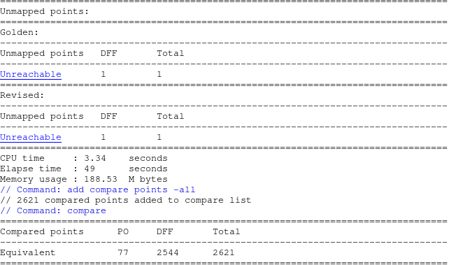
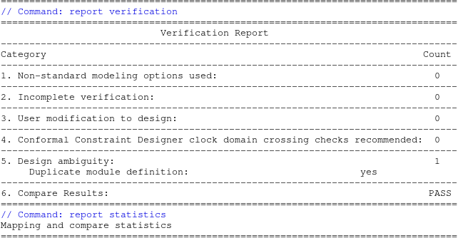
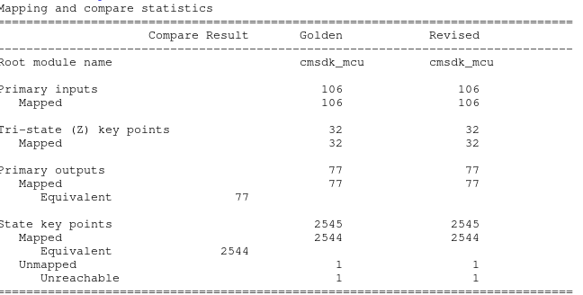
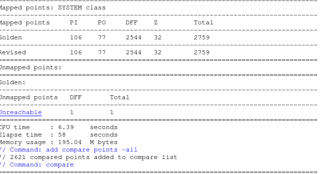
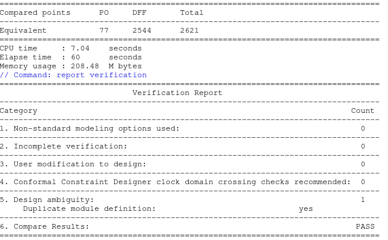
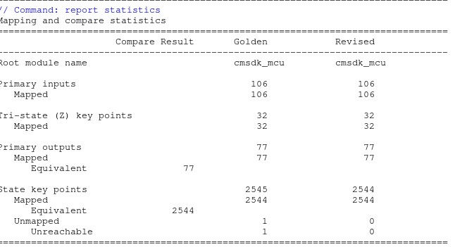

# EC — MCU_UART 등가성 검증 (Pre-Layout & Post-Layout LEC)

본 폴더는 Cadence Conformal LEC를 사용하여 `cmsdk_mcu`의 **합성 전후(Pre-Layout LEC)** 및 **PnR 전후(Post-Layout LEC)** 논리 등가성을 공식 검증한 스크립트와 결과를 정리한다.

---

## 1. 검증 입력 구성 (Golden vs Revised)

| 검증 단계 | 스크립트 | Golden (기준 설계) | Revised (검증 대상) | 공통 라이브러리 |
|---|---|---|---|---|
| **Pre-LEC (Stage 1)** | `mcu_uart_script/mcu_uart_stage1_system.tcl` | `cmsdk_mcu_system` RTL (자작 `uart_apb` 포함) | `mcu_uart_system_syn_final.v` (1단계 합성) | `gsclib045` (`slow`/`fast`) + `giolib045` |
| **Pre-LEC (Stage 2)** | `mcu_uart_script/mcu_uart_stage2_mcu.tcl` | `cmsdk_mcu` Top RTL + 1단계 넷리스트 | `SYN/mcu_uart_mapped/mcu_uart_syn_final.v` (2단계 합성) | `gsclib045` (`slow`/`fast`) + `giolib045` |
| **Post-LEC** | `POST/mcu_uart_script/mcu_uart_post.tcl` | `SYN/mcu_uart_mapped/mcu_uart_syn_final.v` (합성 최종) | `PNR/mcu_uart.v` (PnR 5단계 `saveNetlist -flat`) | `gsclib045` (`slow`/`fast`) + `giolib045` |

---

## 2. 실행 순서

1. Conformal LEC 실행 후 Setup 모드에서 스크립트 로드 (`dofile mcu_uart_script/mcu_uart_stage2_mcu.tcl` 또는 `dofile mcu_uart_script/mcu_uart_post.tcl`).
2. `read library` → `read design -golden` → `read design -revised`로 기준·대상 넷리스트를 로드.
3. `set system mode lec` 전환 → `add compare points -all` → `compare` 수행.
4. `report verification` 및 `report statistics`로 전체 비교점의 Equivalent 100% 및 `Compare Results: PASS` 확인.

---

## 3. 검증 결과 요약

| 항목 | Pre-Layout LEC (`RTL ↔ SYN`) | Post-Layout LEC (`SYN ↔ PNR`) |
|---|:---:|:---:|
| Root Module | `cmsdk_mcu` | `cmsdk_mcu` |
| Primary Inputs (PI) | `106 / 106` Mapped | `106 / 106` Mapped |
| Tri-state (Z) Key Points | `32 / 32` Mapped | `32 / 32` Mapped |
| Primary Outputs (PO) | `77 / 77` **Equivalent** | `77 / 77` **Equivalent** |
| State Key Points (DFF) | `2,544 / 2,544` **Equivalent** | `2,544 / 2,544` **Equivalent** |
| Unmapped (Unreachable DFF) | Golden `1` / Revised `1` | Golden `1` / Revised `0` (PnR 단계 미사용 레지스터 정리) |
| **총 비교점 (PO + DFF)** | **`2,621 / 2,621 Equivalent`** | **`2,621 / 2,621 Equivalent`** |
| **최종 판정 (`Compare Results`)** | **PASS** | **PASS** |

---

## 4. 검증 캡처

### 4-1. Pre-Layout LEC (`RTL ↔ SYN`, `2,621 / 2,621 PASS`)

### 4-2. Post-Layout LEC (`SYN ↔ PNR`, `2,621 / 2,621 PASS`)

