# PNR & Sign-off STA — MCU_UART (Innovus 0~5단계 · Tempus)

본 폴더는 Cadence Innovus(Legacy 모드)와 Tempus를 사용하여 `cmsdk_mcu`(자작 8E1 UART2 통합 Cortex-M0 SoC)의 **Floorplan → PowerPlan → Placement → CTS → Routing/Power → ChipFinish → Sign-off STA** 전 과정을 수행한 스크립트, 리포트 및 단계별 검증 캡처를 정리한다.

---

## 1. 실험 입력 구성 (무엇을 연결하여 PnR을 수행하였는가)

- **게이트 넷리스트**: `../SYN/mcu_uart_mapped/mcu_uart_syn_final.v` + `mcu_uart_add_pad` (전원/코너 패드 53개 결합)
- **IO 배치 및 제약**: `mcu_uart.init.io` (204 PAD = Signal `151` + Power `49` + Corner `4`, 70 ㎛ 피치), `mcu_uart.mmmc.view`, `../SYN/mcu_uart_mapped/mcu_uart_syn_final.sdc` (`8.0 ns` / `125 MHz`, 586행 `set_dont_touch` 주석 해제)
- **물리/타이밍 라이브러리**: GPDK045 45nm SVT (`gsclib045.lef`, `slow_vdd1v0` / `fast_vdd1v0`), IO (`giolib045.lef`, `pads_SS` / `pads_FF`), QRC techfile (`gpdk045.tch`)
- **최종 출력물** (로컬 서버 보관, `.gitignore` 제외): `mcu_uart.gds` (`38 MB`), `mcu_uart.v` (Post-LEC용 flat), `mcu_uart_hier.v` (Post-SIM용 계층형), `mcu_uart_post_wst.sdf`, `mcu_uart_post_bst.sdf`

---

## 2. 단계별 실행 순서 및 최종 결과 요약

| 단계 | 스크립트 | 주요 수행 내용 | 핵심 검증 결과 | 상태 |
|:---:|---|---|---|:---:|
| **0** | `mcu_uart_0_InitDesign.tcl` | Die `4,030 × 4,030 ㎛`, Core `~1,150 × 1,150 ㎛`, 204 PAD 배치 | `dont_touch = 5` (`pad1..4, pad75`만 유지), 0 오류 | 완료 |
| **1** | `mcu_uart_1_PowerPlan.tcl` | Core Power Ring · Stripe · Special Route (`VDD`/`VSS`) | `verify_drc: 0 Viols`, `verifyConnectivity: 0 Viols, 0 Wrngs` | 완료 |
| **2** | `mcu_uart_2_PlaceOpt.tcl` | 표준셀 배치 및 Pre-CTS 최적화 | SDC 수정 후 `optDesign` **Setup WNS `+0.002 ns`**, Violating **`0 / 4,861`**, `max_cap 0`, Density `3.681%` | 완료 |
| **3** | `mcu_uart_3_PostCTSopt.tcl` | CCOpt 클록 트리 합성 및 Post-CTS 최적화 | Setup `reg2reg +0.003 ns` (`0` viol), **Hold `+0.052 ns` (`0` viol)**, Clock Skew **`0.132 ns`**, Density `3.762%` | 완료 |
| **4** | `mcu_uart_4_RouteDesign_PowerAnalysis.tcl` | NanoRoute 상세 배선, Post-Route 최적화(`holdTargetSlack 0.02`), 정적 전력 해석 | **Setup `+0.026 ns`** (`reg2reg +0.186`, `0` viol), **Hold `+0.005 ns`** (`reg2reg +0.052`, `0` viol), **DRC `0`**, **Conn `0`**, Total Power **`77.47 mW`** | 완료 |
| **5** | `mcu_uart_5_ChipFinish.tcl` | `84,454`개 Filler 삽입, 최종 DRC/Conn 검증, GDS/Netlist/SDF 출력 | **`84,454` fillers**, `verify_drc: 0 Viols`, `verifyConnectivity: 0 Viols, 0 Wrngs` | 완료 |
| **STA** | `mcu_uart_tempus.tcl` | Tempus Sign-off RC 추출, 전 9종 타이밍 체크, Worst/Best SDF 출력 | **Real Net `100.00%`** (`21,252 / 21,252`), **전 항목 Violated `0`**, Setup **`+0.015 ns`**, Hold **`+0.007 ns`** (**6단계 ECO 불필요**) | 완료 |

---

## 3. 주요 트러블슈팅 요약

1. **2단계 `PlaceOpt` Setup 대량 위반 (`WNS -5.189 ns`, `861` 경로)**:
   - **원인**: 2단계 합성 SDC 586행의 `set_dont_touch [get_cells u_cmsdk_mcu_system]`이 `PowerPlan.dat` 내부 속성에 캐시되어 코어 내부 최적화를 차단함.
   - **해결**: SDC 586행을 주석 처리하고 `0 → 1 → 2`단계를 클린 재실행하여 `optDesign` WNS **`+0.002 ns` (`0` 위반)**으로 해소.
2. **4단계 `verifyConnectivity` 32건 위반 및 `FILLER_W_29/VDD` 흰색 X 마커**:
   - **원인**: GPDK045 `giolib045.lef`의 `PADVDD` 매크로에 Metal4 IO 링 패스스루 핀 정의가 누락되어 `verifyConnectivity`가 IO 링 레일 조각을 단선으로 오탐함.
   - **해결**: `verifyConnectivity -ignorePGPin $ioRingPgPins`를 4·5단계에 적용(코어 전원 `PADVDD:VDD`/`PADVSS:VSS` 및 전체 시그널 넷은 100% 검사 유지)하여 **`0 Viols, 0 Wrngs`** 달성 및 X 마커 제거.
3. **Tempus Sign-off 1회 통과 (6단계 ECO 생략)**:
   - **조치**: 4단계 Post-Route Hold 최적화에 `setOptMode -holdTargetSlack 0.02`를 선제 반영하여 Tempus Sign-off 기준 Setup `+0.015 ns`, Hold `+0.007 ns`, 전 9종 체크 `Violated = 0`을 1회에 달성함.

---

## 4. 단계별 레이아웃 및 리포트 캡처

### 4-1. 0단계 — Init Design (`4,030 × 4,030 ㎛`, 204 PAD)

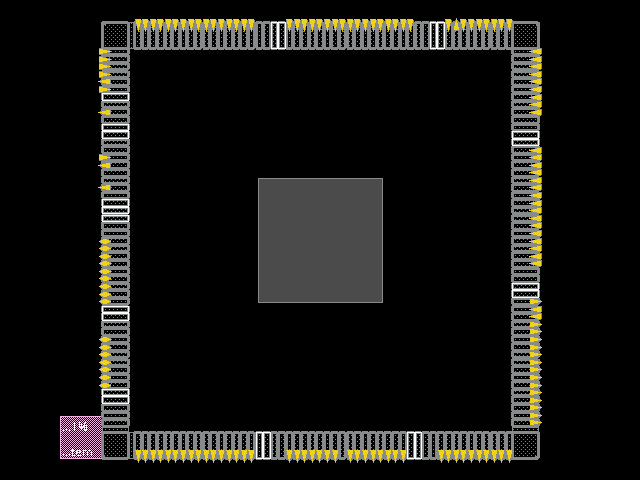

### 4-2. 1단계 — Power Plan (`DRC 0`, `Conn 0`)

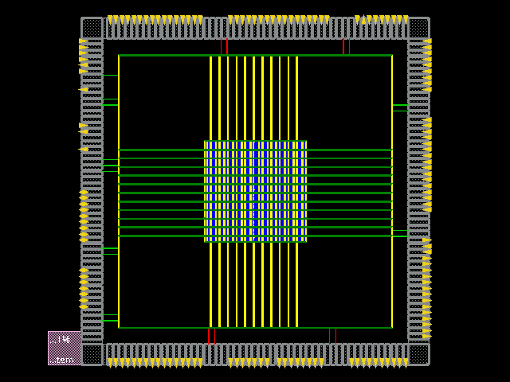

### 4-3. 2단계 — Place & Optimization (`set_dont_touch` 수정 전후 비교)

#### (1) 수정 전 (`set_dont_touch` 활성: Setup WNS `-5.189 ns`, `861` 경로 위반)

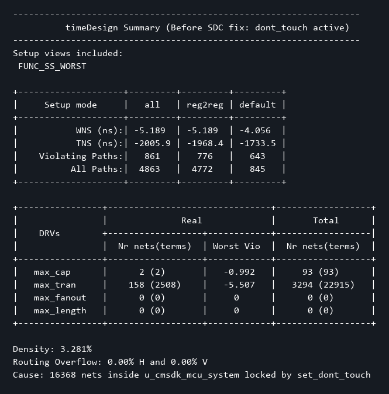

#### (2) 수정 후 (`u_cmsdk_mcu_system` 잠금 해제: `optDesign` WNS `+0.002 ns`, `0` 위반)

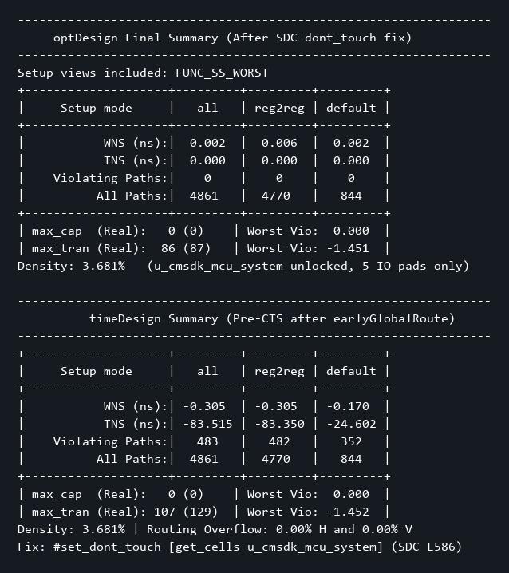

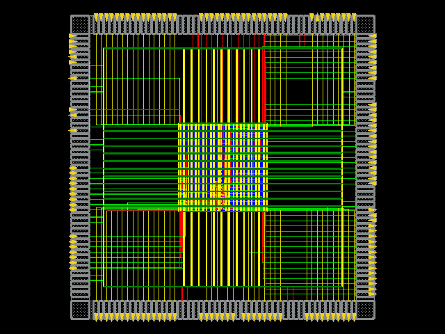

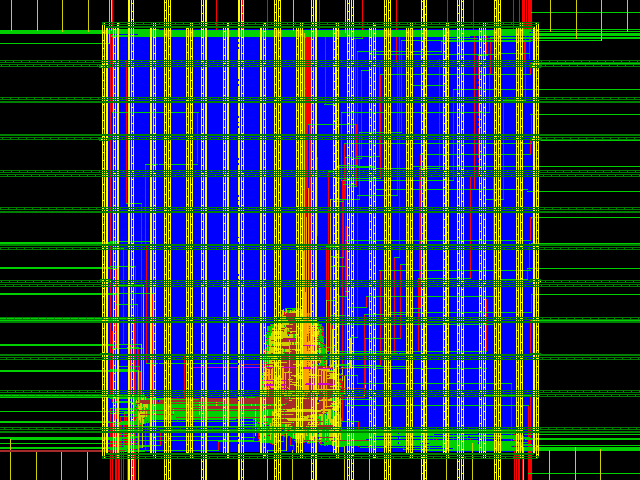

### 4-4. 3단계 — Post-CTS Optimization (Hold `+0.052 ns`, Clock Skew `0.132 ns`)

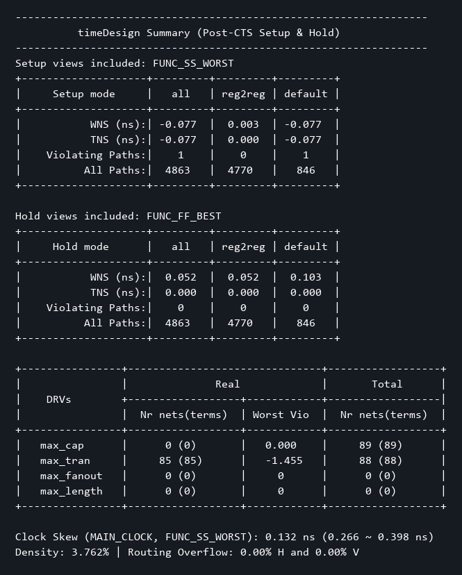

### 4-5. 4단계 — Route Design & Power Analysis (`DRC 0`, `Conn 0`, `77.47 mW`)

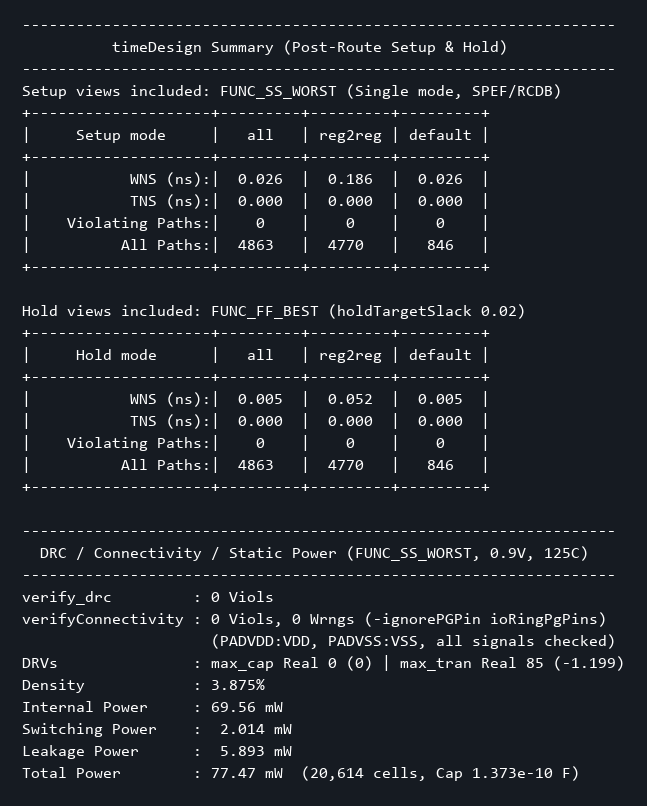

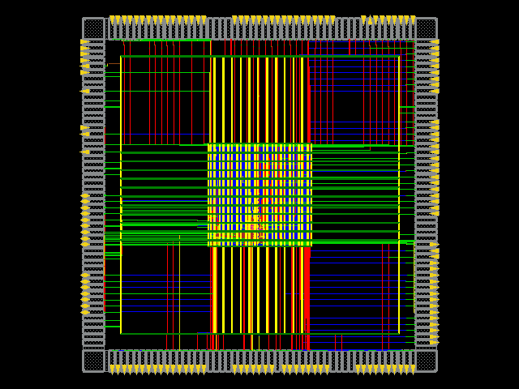

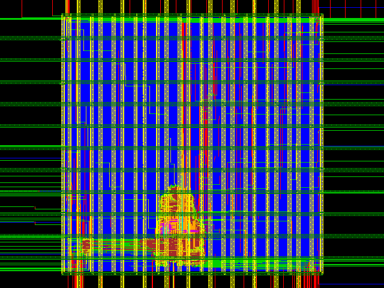

### 4-6. 5단계 — Chip Finish (`84,454` Fillers, `DRC 0`, `Conn 0`)

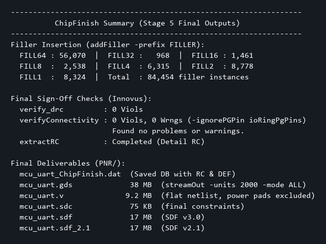

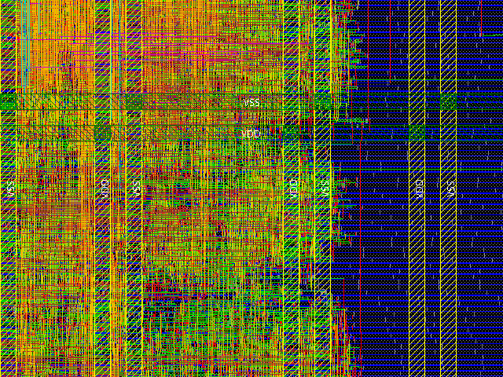

### 4-7. Tempus Sign-off STA (Real Net `100%`, 전 9종 체크 `0 Violated`)

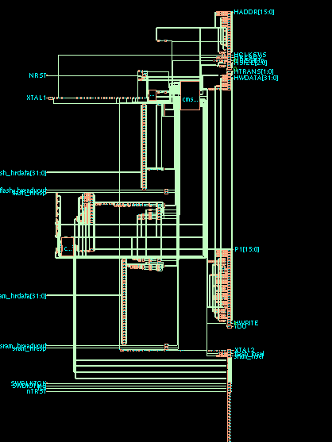

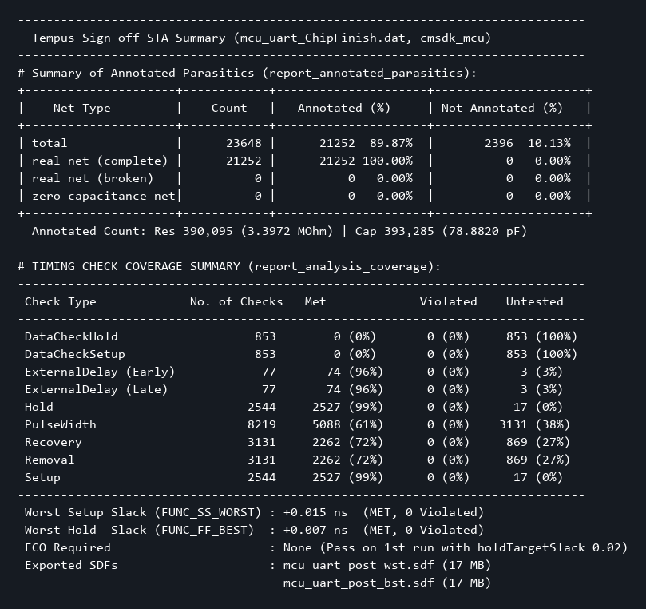
