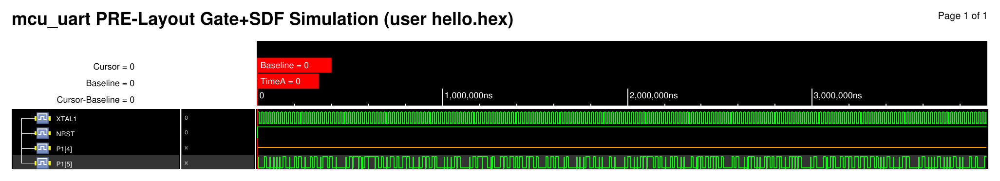
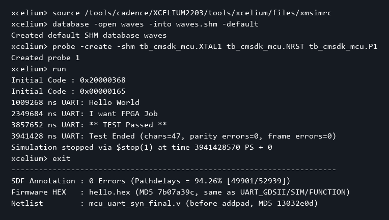
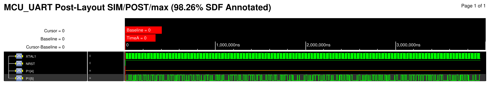
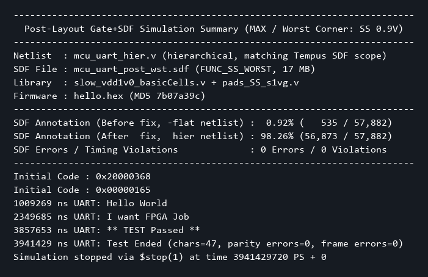
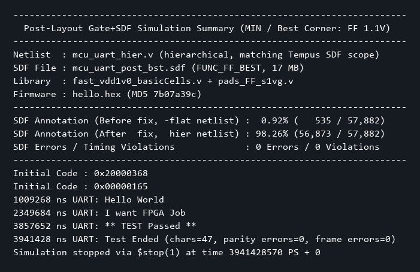

# SIM — MCU_UART 시뮬레이션 (UNIT · FUNCTION · PRE · POST max/min)

본 폴더는 Cadence Xcelium(`xrun`)을 사용하여 자작 APB UART 단위 검증부터 ARM Cortex-M0 SoC 전체의 **Pre-Layout Gate+SDF** 및 **Post-Layout Gate+SDF (`max`/`min`)** 시뮬레이션까지 단계별로 수행한 스크립트와 결과를 정리한다.

---

## 1. 실험 입력 구성 (무엇을 연결하여 검증하였는가)

| 단계 | 폴더 / 스크립트 | DUT 입력 | 테스트벤치 및 펌웨어 | 타이밍 / 라이브러리 모델 |
|---|---|---|---|---|
| **1. 단위 검증** | `UNIT_UART_APB/run_unit.tcl` | `uart_apb` RTL 6개 | `tb_uart_apb_wrapper.v` (자체 작성) | Zero-delay RTL |
| **2. RTL 기능** | `FUNCTION/run_function.tcl` | Cortex-M0 + `uart_apb` 전체 RTL | `tb_cmsdk_mcu.v` + `uart_capture_8e1.v` + `hello.hex` | Zero-delay (`+define+function_sim`) |
| **3. Pre-Layout** | `PRE/run_pre.tcl` | `SYN/mcu_uart_mapped/mcu_uart_syn_final.v` | `tb_cmsdk_mcu.v` + `uart_capture_8e1.v` + `hello.hex` | `mcu_uart_delays.sdf` (`+define+sdf_gate`) + `slow_vdd1v0_basicCells.v` + `pads_FF_s1vg.v` |
| **4. Post-Layout (Worst)** | `POST/max/run_post_max.tcl` | `PNR/mcu_uart_hier.v` (계층형 PnR 넷리스트) | `tb_cmsdk_mcu.v` + `uart_capture_8e1.v` + `hello.hex` | Tempus `mcu_uart_post_wst.sdf` (`+define+sdf_post_wst`) + `slow_vdd1v0_basicCells.v` + `pads_SS_s1vg.v` |
| **5. Post-Layout (Best)** | `POST/min/run_post_min.tcl` | `PNR/mcu_uart_hier.v` (계층형 PnR 넷리스트) | `tb_cmsdk_mcu.v` + `uart_capture_8e1.v` + `hello.hex` | Tempus `mcu_uart_post_bst.sdf` (`+define+sdf_post_bst`) + `fast_vdd1v0_basicCells.v` + `pads_FF_s1vg.v` |

> **8E1 수신 모니터 (`TESTBENCH/uart_capture_8e1.v`)**: 기존 CMSDK 테스트벤치의 8N1 수신기는 패리티 비트를 판별하지 못하므로, `115200 baud` 8E1 프레임(Start + 8 Data + Even Parity + Stop)을 실시간 복호하고 패리티 오류(`PE`)·프레임 오류(`FE`)를 집계하는 수신 모니터를 별도 작성하여 연결하였다.

---

## 2. 실행 순서

1. **단위 검증**: `UNIT_UART_APB/`에서 `./run_unit.tcl` 실행 → APB 레지스터 접근 및 TX→RX 8E1 루프백 `23/23 PASS` 확인.
2. **RTL 기능 검증**: `FUNCTION/`에서 `./run_function.tcl` 실행 → Cortex-M0 부팅 후 UART2로 `hello.hex` 문자열 출력 확인.
3. **Pre-Layout Gate+SDF**: `PRE/`에서 `./run_pre.tcl` 실행 → 합성 넷리스트 + Genus SDF 백어노테이션 상태에서 문자열 및 오류 `0` 확인.
4. **Post-Layout Gate+SDF (`max` / `min`)**: `POST/max/run_post_max.tcl` 및 `POST/min/run_post_min.tcl` 실행 → PnR 최종 계층 넷리스트 + Tempus Worst/Best SDF 상태에서 전 구간 타이밍 위반 `0` 및 `** TEST Passed **` 통과 확인.

---

## 3. 핵심 트러블슈팅 — Post-Layout SDF 적용률 `0.92% → 98.26%` 개선

- **문제 현상**: 초기 Post-Layout 시뮬레이션에 `saveNetlist -flat`으로 출력한 평면 넷리스트(`PNR/mcu_uart.v`)와 Tempus 계층형 SDF(`DIVIDER /`)를 연결한 결과, 계층 스코프 불일치(`SDFINF`)로 SDF 적용률이 `0.92% (535 / 57,882)`에 그쳤다.
- **원인 분석**: Post-LEC용 `mcu_uart.v`는 `-flat` 옵션으로 계층 구분자가 평탄화되어 있으나, Tempus SDF는 `u_cmsdk_mcu_system/...` 계층 경로를 유지한다.
- **해결 조치**: Post-LEC 기준 파일(`PNR/mcu_uart.v`)은 수정하지 않고 보존한 채, `mcu_uart_ChipFinish.dat`에서 계층형 넷리스트 `PNR/mcu_uart_hier.v`를 별도 출력하여 `POST/max`와 `POST/min` 스크립트에 연결하였다.
- **개선 결과**: `max`·`min` 양 코너 모두 SDF 적용률이 **`98.26% (56,873 / 57,882)`**로 상승하였으며, 최악/최적 코너 간 실제 지연 차이(`3,941,429.72 ns` vs `3,941,428.57 ns`, `+1.15 ns`)와 타이밍 위반 `0`을 함께 확인하였다.

---

## 4. 검증 결과 및 캡처

| 검증 단계 | SDF 적용률 | 에러 / 타이밍 위반 | UART2 수신 결과 (`uart_capture_8e1`) | 종료 시각 | 판정 |
|---|:---:|:---:|---|---|:---:|
| **Pre-Layout (`PRE`)** | `94.26%` (`49,901 / 52,939`) | `0` / `0` | `Hello World` / `I want FPGA Job` / `** TEST Passed **` (`chars=47`, PE `0`, FE `0`) | `~3.94 ms` | **PASS** |
| **Post-Layout (`POST/max`)** | **`98.26%`** (`56,873 / 57,882`) | `0` / `0` | `Hello World` / `I want FPGA Job` / `** TEST Passed **` (`chars=47`, PE `0`, FE `0`) | `3,941,429.72 ns` | **PASS** |
| **Post-Layout (`POST/min`)** | **`98.26%`** (`56,873 / 57,882`) | `0` / `0` | `Hello World` / `I want FPGA Job` / `** TEST Passed **` (`chars=47`, PE `0`, FE `0`) | `3,941,428.57 ns` | **PASS** |

### 4-1. Pre-Layout Gate+SDF 시뮬레이션

### 4-2. Post-Layout Gate+SDF — Worst Corner (`POST/max`, SS `0.9 V` / `125 ℃`)

### 4-3. Post-Layout Gate+SDF — Best Corner (`POST/min`, FF `1.1 V` / `0 ℃`)

