# EC — UART_GDSII 등가성 검증 (Pre-Layout & Post-Layout LEC)

본 폴더는 Cadence Conformal LEC를 사용하여 **`uart_pad`** 및 **`uart_no_pad`**의 합성 전후(Pre-LEC) 및 PnR 전후(Post-LEC) 논리 등가성을 검증한 스크립트와 결과를 정리한다.

---

## 1. 검증 입력 구성

| 대상 및 단계 | Golden (기준 설계) | Revised (검증 대상) | 비고 |
|---|---|---|---|
| **`uart_pad` Pre-LEC** | `RTL/*.v` 5개 (`-define USE_IO_PAD`) | `SYN/uart_mapped/uart_top_syn_final.v` | 스크립트: `EC/uart_script.tcl` |
| **`uart_pad` Post-LEC** | `SYN/uart_mapped/uart_top_syn_final.v` | `PNR/uart_pad_outputs/uart_top_pad.v` | 전원 패드 16개 BBOX(Unreachable), 시그널 패드 28개 ECO 포함 |
| **`uart_no_pad` Pre-LEC** | `RTL/*.v` 5개 (매크로 미정의) | `SYN/uart_block_mapped/uart_top_syn_final.v` | 순수 코어 블록 |
| **`uart_no_pad` Post-LEC** | `SYN/uart_block_mapped/uart_top_syn_final.v` | `PNR/uart_block_outputs/uart_top_block.v` | PnR 5단계 `saveNetlist -flat` |

---

## 2. 실행 순서 및 요약 결과

1. Conformal LEC Setup 모드에서 표준셀/IO 패드 Verilog 라이브러리(`slow_vdd1v0`, `fast_vdd1v0`, `pads_SS`)와 Golden/Revised 디자인을 순차 로드.
2. `set system mode lec` → `add compare points -all` → `compare` 수행.
3. `report verification` 및 `report statistics`로 전체 비교점(`PO 17 + DFF 339 = 356`) 100% 등가 및 `Compare Results: PASS` 확인.

| 검증 항목 | PI (Mapped) | PO (Equivalent) | DFF (Equivalent) | 총 비교점 | 판정 |
|---|:---:|:---:|:---:|:---:|:---:|
| **`uart_pad` Pre-LEC** | `13 / 13` | `17 / 17` | `339 / 339` | **`356 / 356`** | **PASS** |
| **`uart_pad` Post-LEC** | `13 / 13` | `17 / 17` | `339 / 339` | **`356 / 356`** (Power PAD 16 BBOX) | **PASS** |
| **`uart_no_pad` Pre-LEC** | `13 / 13` | `17 / 17` | `339 / 339` | **`356 / 356`** | **PASS** |
| **`uart_no_pad` Post-LEC** | `13 / 13` | `17 / 17` | `339 / 339` | **`356 / 356`** | **PASS** |

---

## 3. `uart_pad` 검증 캡처

### 3-1. `uart_pad` Pre-Layout LEC (`RTL ↔ SYN`)

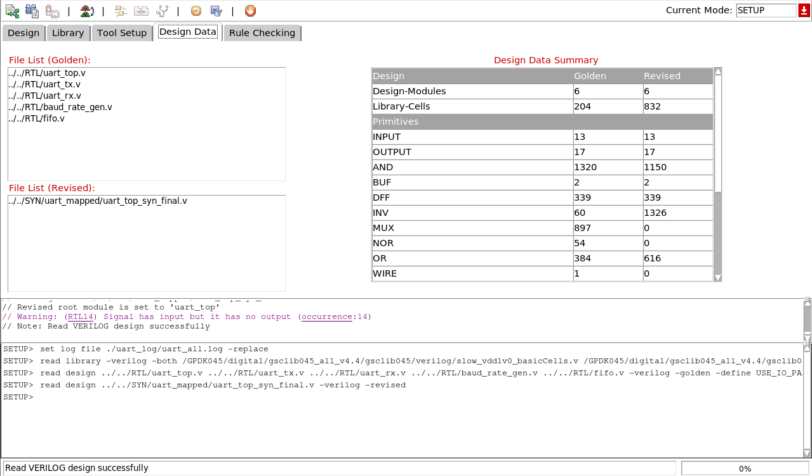

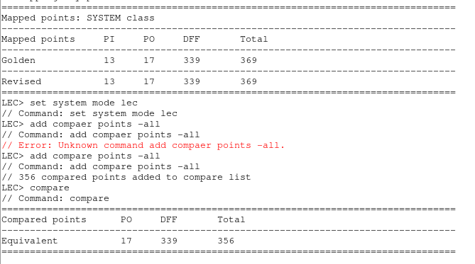

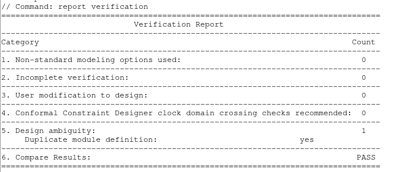

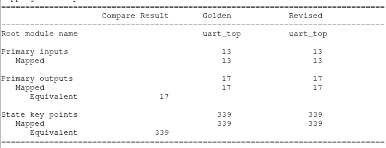

### 3-2. `uart_pad` Post-Layout LEC (`SYN ↔ PNR`)

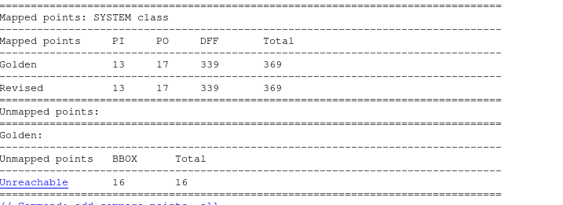

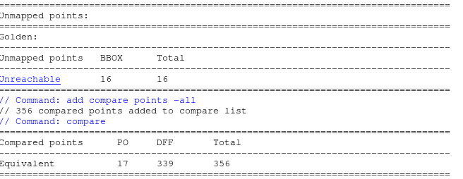

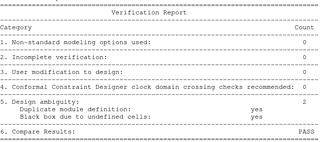

---

## 4. `uart_no_pad` 검증 캡처

### 4-1. `uart_no_pad` Pre-Layout LEC (`RTL ↔ SYN`)

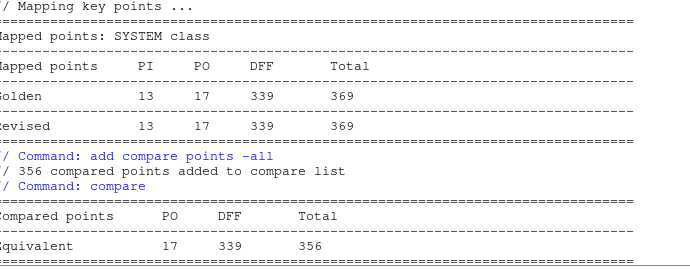

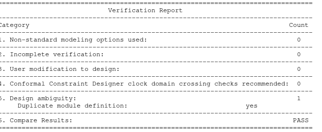

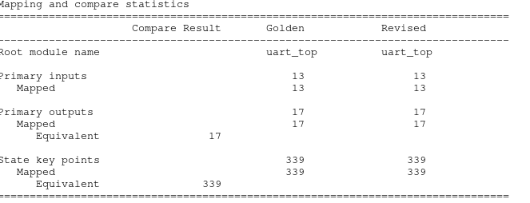

### 4-2. `uart_no_pad` Post-Layout LEC (`SYN ↔ PNR`)

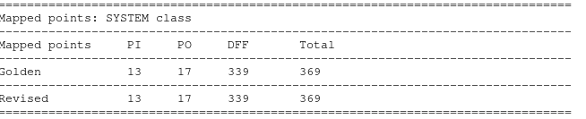

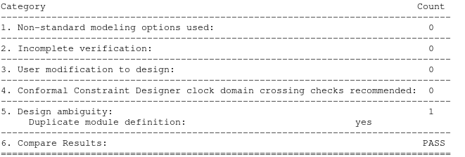

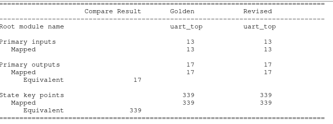
