# PNR & Sign-off STA — UART_GDSII (`uart_pad` & `uart_no_pad`)

본 폴더는 Cadence Innovus(Legacy 모드)와 Tempus를 사용하여 자작 8E1 UART IP를 **단독 칩(`uart_pad/`, 46 PAD)**과 **코어 블록(`uart_no_pad/`, PAD 제외)** 두 가지 형태로 PnR 0~5단계 및 Sign-off STA까지 완료한 스크립트, 분석 차트(SVG), 실제 레이아웃·리포트 캡처를 통합 정리한다.

---

## 전체 비교 요약

| 항목 | `uart_pad` (단독 칩, `uart_pad/`) | `uart_no_pad` (코어 블록, `uart_no_pad/`) |
|---|---|---|
| 입력 넷리스트 | `SYN/uart_mapped/uart_top_syn_final.v` + `uart_add_pad` | `SYN/uart_block_mapped/uart_top_syn_final.v` (`0.01 pF` 재합성) |
| 다이 / 코어 구성 | Die `1,748 × 1,748 ㎛`, Core `468 × 468 ㎛` (여백 `640 ㎛`), 46 PAD | Core Util `55%`, Margin `20 ㎛` (4변, PAD 없음) |
| 타겟 클록 | `10.0 ns` (`100 MHz`, `FUNC_SS_WORST` / `FUNC_FF_BEST`) | `10.0 ns` (`100 MHz`, `FUNC_SS_WORST` / `FUNC_FF_BEST`) |
| 최종 Setup WNS / Violating | **`+6.103 ns`** / `0` (`reg2reg +7.399 ns`) | **`+7.769 ns`** / `0` (`reg2reg +7.833 ns`) |
| 최종 Hold WNS / Violating | **`+0.003 ns`** / `0` | **`+0.013 ns`** / `0` (`reg2reg +0.058 ns`) |
| DRVs (`max_cap`/`max_tran`) | **`0 / 0`** | **`0 / 0`** |
| DRC / Connectivity | **`0 / 0`** (`-ignorePGPin` 적용) | **`0 / 0`** |
| 정적 전력 (`FUNC_SS_WORST`) | **`12.51 mW`** (`1,053` cells, Cap `6.388 pF`) | **`0.1425 mW`** (`984` cells, Cap `2.604 pF`) |
| Tempus Sign-off STA | Real Net **`100.00%`** (`1,099/1,099`), **전 항목 `0 Violated`** | Removal `5 → 0`, **전 항목 `0 Violated`** |

---

# Part 1. `uart_pad` — 패드 포함 단독 칩 (`uart_pad/`)

## 1-1. 단계별 진행 요약

| 단계 | 스크립트 | 상태 | 주요 결과 및 트러블슈팅 |
|:---:|---|:---:|---|
| **0** | `uart_pad_0_InitDesign.tcl` | 완료 | Die `1,748 × 1,748 ㎛` (`0.19`/`0.2` 격자 공배수), `placeInstance`로 `PADVDD`/`PADVSS` 포함 전원 패드 16개 배치 |
| **1** | `uart_pad_1_PowerPlan.tcl` | 완료 | 전원 링·스트라이프·SRoute 완료, `-ignorePGPin` 적용으로 연결 점검 `40 → 0` |
| **2** | `uart_pad_2_PlaceOpt.tcl` | 완료 | Setup WNS `+7.835 ns` (`optDesign +7.837 ns`), DRV `0`, Density `1.780%` |
| **3** | `uart_pad_3_PostCTSopt.tcl` | 완료 | Hold·Removal 위반 **`211 → 0`** (`-0.235 ns → +0.002 ns`, 입력 9넷 `ecoAddRepeater`), Setup `+7.399 ns` |
| **4** | `uart_pad_4_RouteDesign_PowerAnalysis.tcl` | 완료 | 시그널 패드 28개 ECO + 클록 루트 버퍼(`CLKBUFX8`), `max_tran` **`22넷 → 0`**, Setup `+6.103 ns`, Hold `+0.019 ns` → 최종 `+0.003 ns`, 전력 `12.51 mW` |
| **5** | `uart_pad_5_ChipFinish.tcl` | 완료 | Filler 삽입, DRC `0`, Conn `0`, GDS/Netlist/SDC/SDF 출력 |
| **STA** | `uart_pad_tempus.tcl` | 완료 | Real Net `100.00%` (`1,099/1,099`), `uart_pad` 회로도 확인, **전 9종 체크 `0 Violated`** |

## 1-2. 칩 배치 및 타이밍 분석 (SVG 차트)

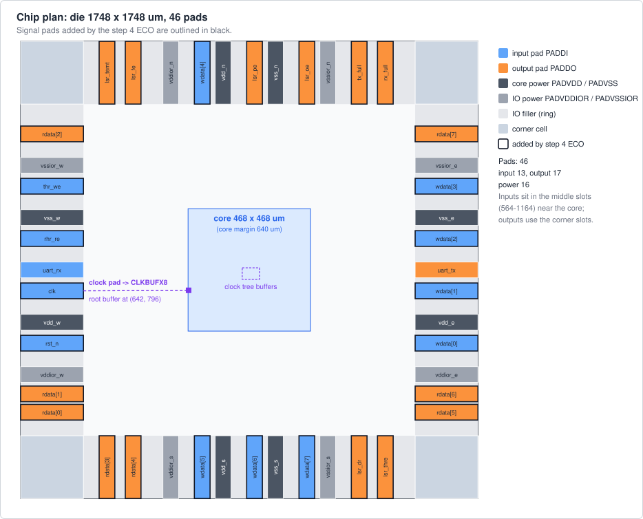

- **패드 46개**: 전원 16개(4변 각 `PADVDDIOR`·`PADVDD`·`PADVSS`·`PADVSSIOR`) + 시그널 30개(RX·TX 2개는 합성 포함, 28개는 4단계 라우팅 전 ECO로 삽입).
- 입력 패드는 코어에 가까운 각 변 중앙(`564~1164 ㎛`)에 배치하고, 클록 경로(`~630 ㎛`)에는 코어 왼쪽 가장자리에 루트 버퍼(`u_clk_pad_buf`, `CLKBUFX8`)를 삽입하여 `max_tran` 위반을 `0`으로 제거하였다.

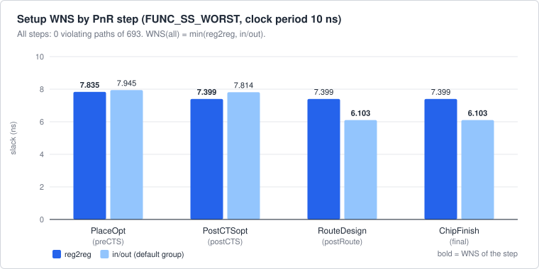

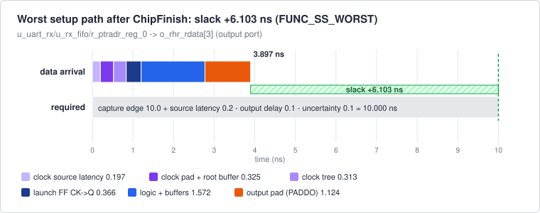

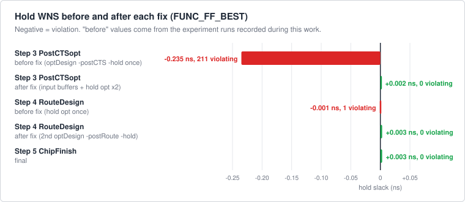

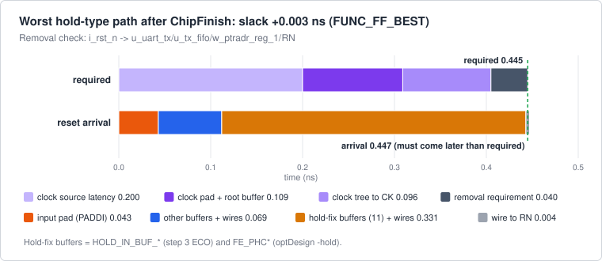

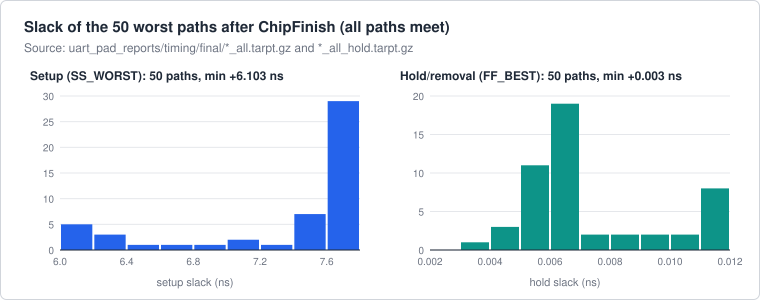

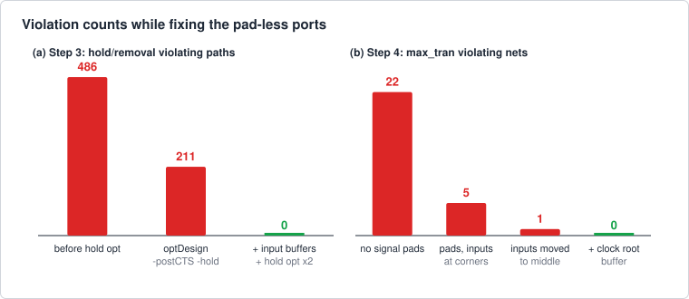

## 1-3. `uart_pad` 단계별 실제 캡처

### 0단계 — Init Design (`PADVDD`/`PADVSS` AREAIO 배치 오류 해결 과정)

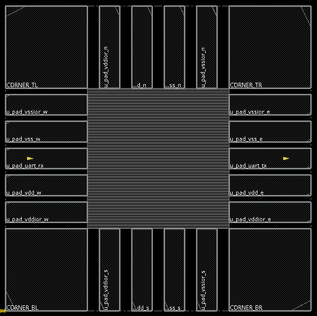

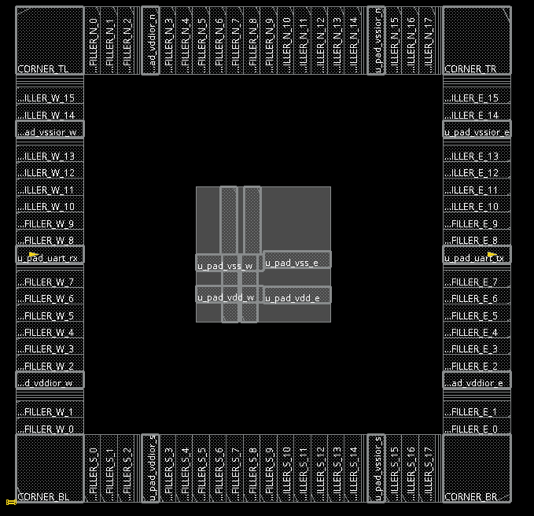

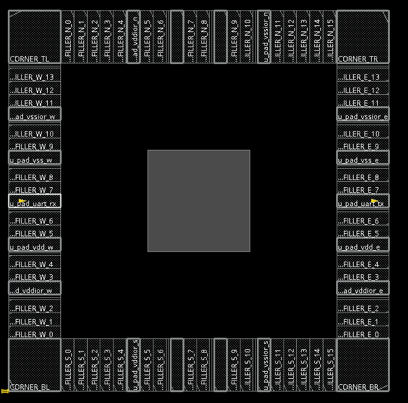

### 1단계 — Power Plan

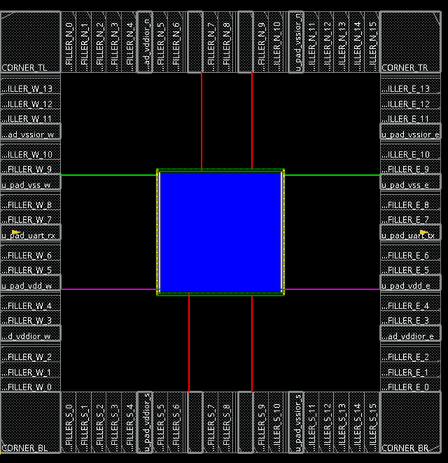

### 2단계 — Place & Optimization (`WNS +7.837 ns`, `DRV 0`)

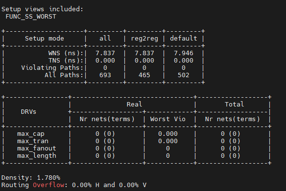

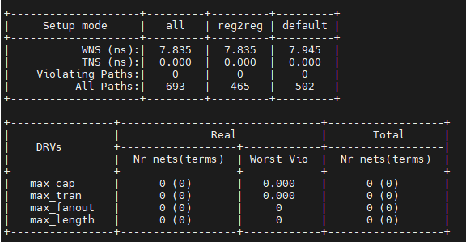

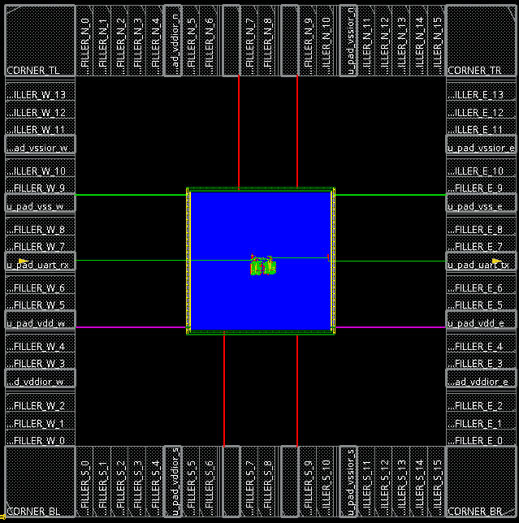

### 3단계 — Post-CTS Optimization (`Hold -0.235 ns / 211 viols → +0.002 ns / 0 viols`)

#### (1) 수정 전 (Hold·Removal 211건 위반, WNS `-0.235 ns`)

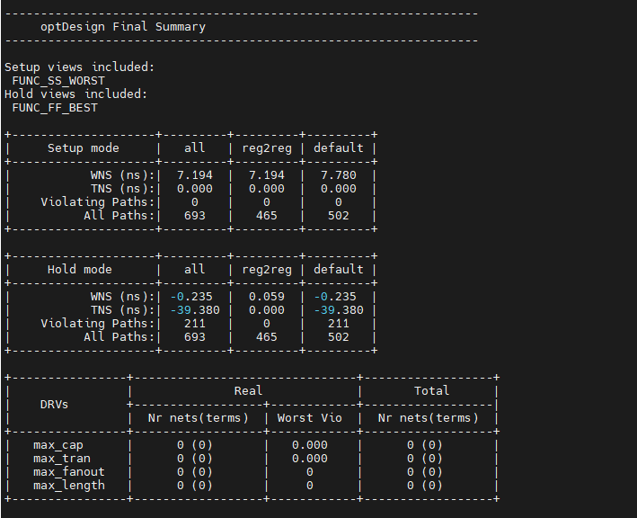

#### (2) 수정 후 (`ecoAddRepeater` + Hold 최적화 2회: Hold WNS `+0.002 ns`, `0` 위반)

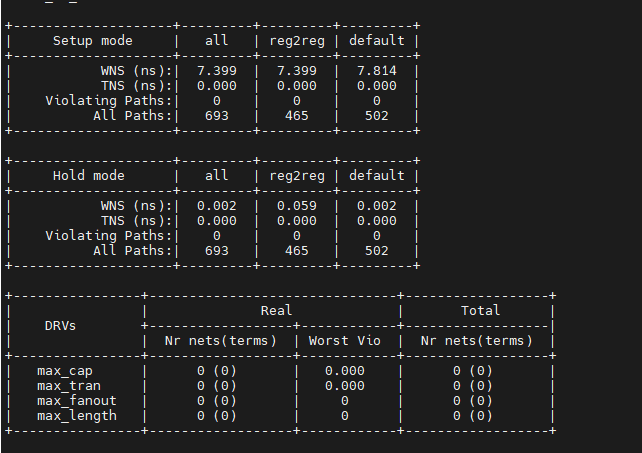

### 4단계 — Route Design & Power Analysis (시그널 패드 28개 ECO, `max_tran 22 → 0`)

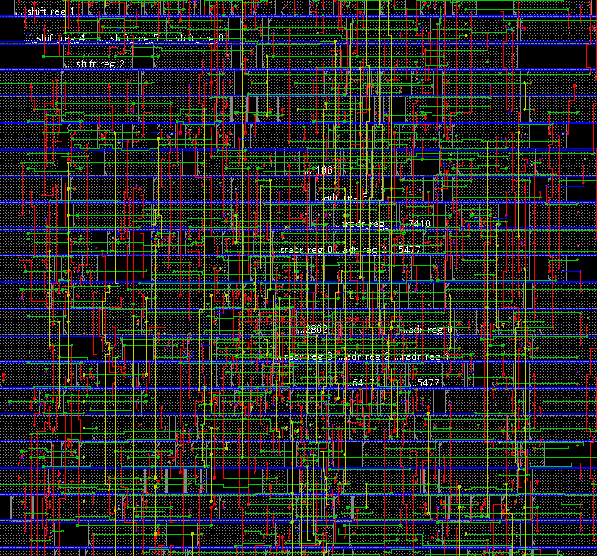

#### (1) 패드 ECO 전 (`max_tran` Real `21` / Total `22`, 최악 `-1.435 ns`)

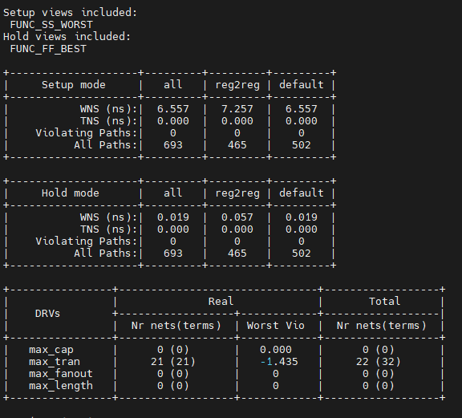

#### (2) 시그널 패드 28개 ECO + 클록 루트 버퍼 반영 후 (Setup `+6.103 ns`, `DRV 0`)

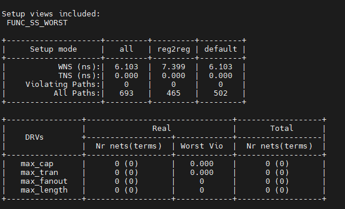

### 5단계 — Chip Finish (Filler 삽입 및 FIFO 확대 뷰)

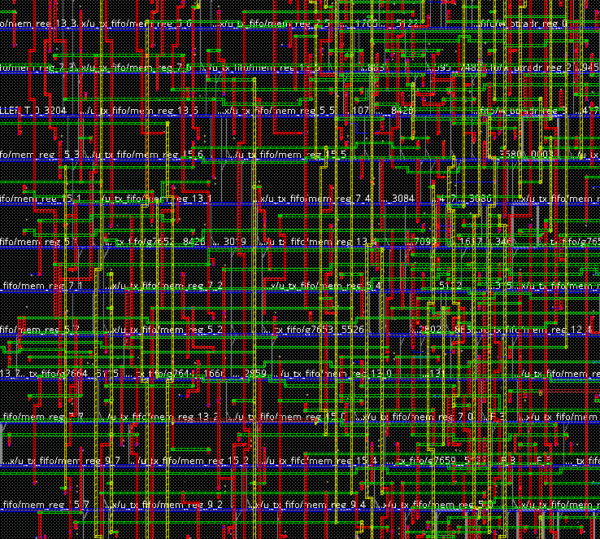

### Tempus Sign-off STA (`Real Net 100.00%`, `0 Violated`)

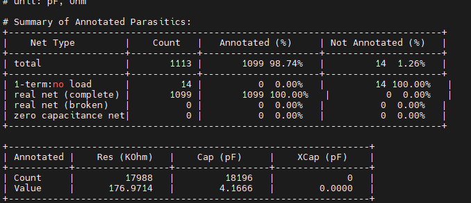

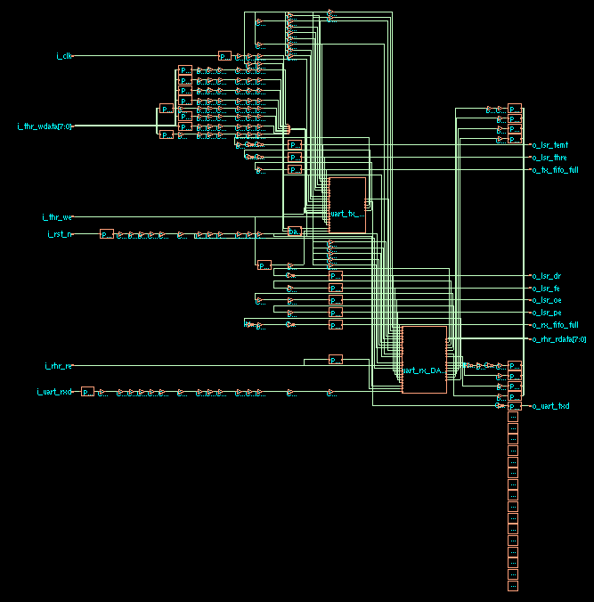

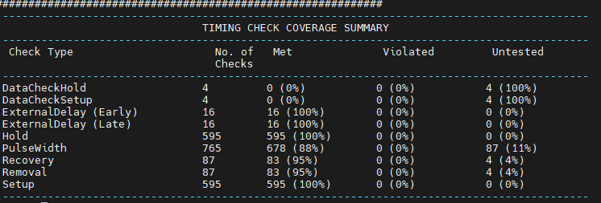

---

# Part 2. `uart_no_pad` — 패드 제외 코어 블록 (`uart_no_pad/`)

## 2-1. 단계별 진행 요약

| 단계 | 스크립트 | 상태 | 주요 결과 및 트러블슈팅 |
|:---:|---|:---:|---|
| **0** | `0_uart_InitDesign.tcl` | 완료 | `floorPlan -site CoreSite -r 1.0 0.55 20 20 20 20` (코어 활용률 55%, 4변 여백 `20 ㎛`) |
| **1** | `1_uart_PowerPlan.tcl` | 완료 | Metal10/Metal11 링(`8 wires`, `8 vias`) 및 SRoute 완료, `verifyConnectivity 0` |
| **2** | `2_uart_PlaceOpt.tcl` | 완료 | `o_uart_txd` 부하 `1.0 pF → 0.01 pF` 재합성으로 `max_cap`/`max_tran` **`1 → 0`**, Setup WNS **`+7.802 ns`**, Density `55.674%` |
| **3** | `3_uart_PostCTSopt.tcl` | 완료 | Setup WNS **`+7.744 ns`** (`reg2reg +7.808 ns`), DRV `0`, Density `58.777%` |
| **4** | `4_uart_RouteDesign_PowerAnalysis.tcl` | 완료 | `setOptMode -holdTargetSlack 0.02` 반영으로 Hold **`-0.006 ns (5 viols) → +0.013 ns (0 viols)`**, Setup `+7.769 ns`, DRC·Conn `0/0`, 전력 `0.1425 mW` |
| **5** | `5_uart_ChipFinish.tcl` | 완료 | Filler 삽입, DRC·Conn `0/0`, `uart_top_block.gds` 및 `uart_top_block.v` 출력 |
| **STA** | Tempus Sign-off STA | 완료 | 4단계 `holdTargetSlack 0.02` 반영으로 Tempus Removal 위반 **`5 → 0`**, 전 항목 **`0 Violated`** |

## 2-2. `uart_no_pad` 단계별 실제 캡처

### 0단계 — Init Design

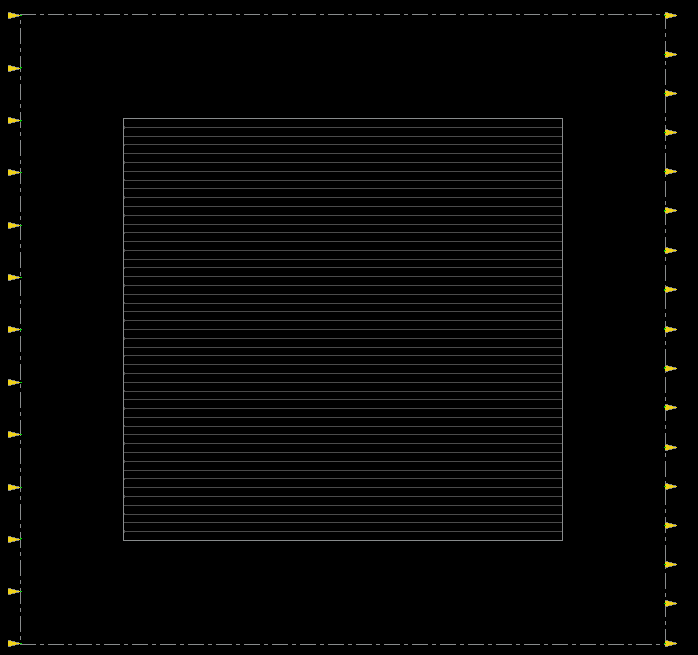

### 1단계 — Power Plan (`addRing`: Metal10/11 8 wires, Via10 8 vias)

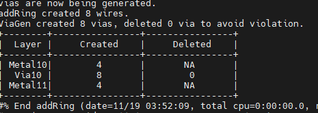

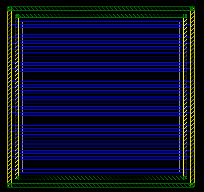

### 2단계 — Place & Optimization (`o_uart_txd` 부하 `1.0 pF → 0.01 pF` 재합성 전후)

#### (1) 수정 전 (`1.0 pF` 부하 잔존: `max_cap 1 (-0.704)`, `max_tran 1 (-1.282)`)

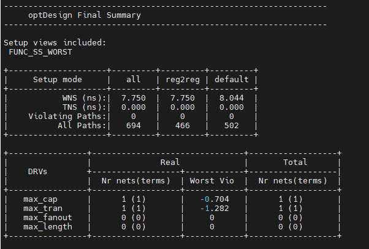

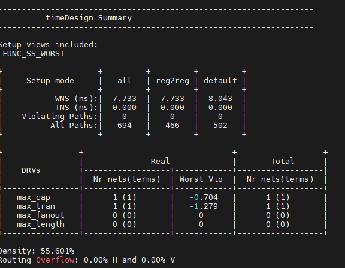

#### (2) 수정 후 (`0.01 pF` 재합성: `max_cap 0`, `max_tran 0`, Setup WNS `+7.802 ns`)

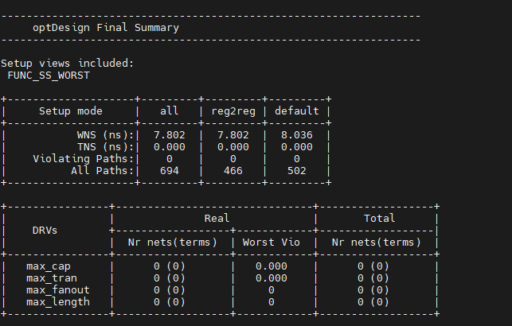

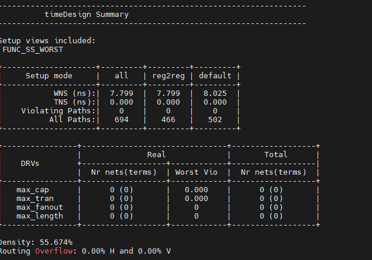

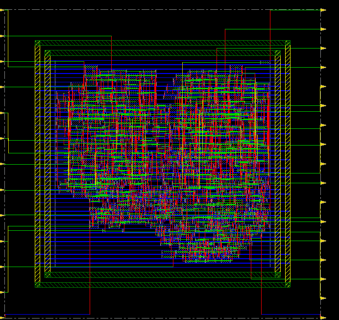

### 3단계 — Post-CTS Optimization (`WNS +7.744 ns`, `DRV 0`)

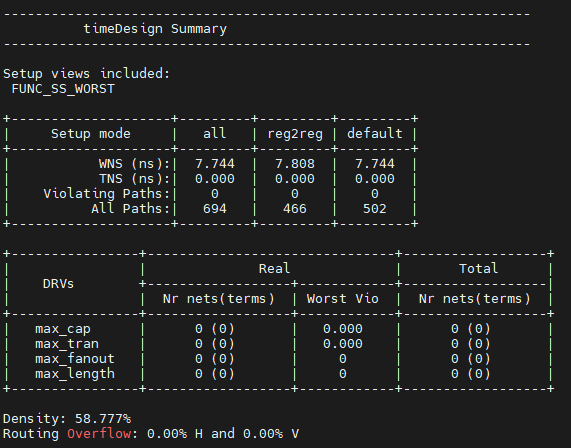

### 4단계 — Route Design & Power Analysis (`holdTargetSlack 0.02` 수정 전후)

#### (1) 수정 전 (Hold WNS `-0.006 ns`, `5` 경로 위반)

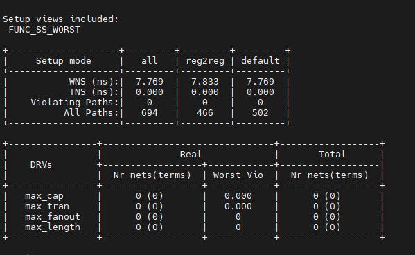

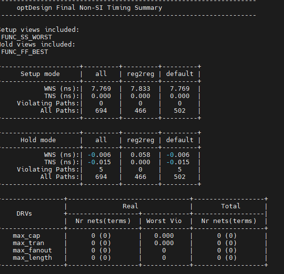

#### (2) 수정 후 (`setOptMode -holdTargetSlack 0.02`: Hold WNS `+0.013 ns`, `0` 위반)

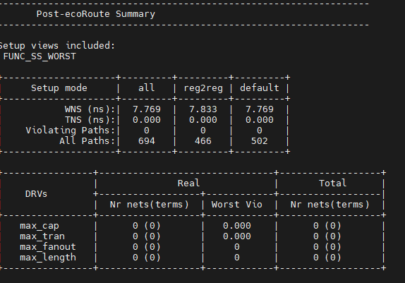

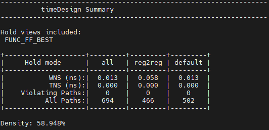

### 5단계 — Chip Finish (Filler 삽입 최종 레이아웃)

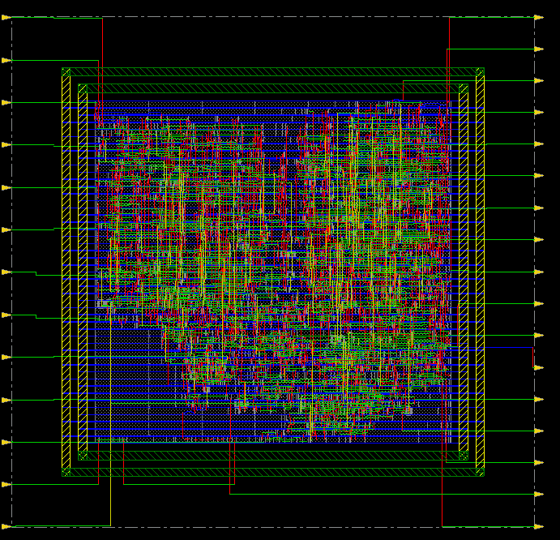

### Tempus Sign-off STA (Removal `5 → 0 Violated`)

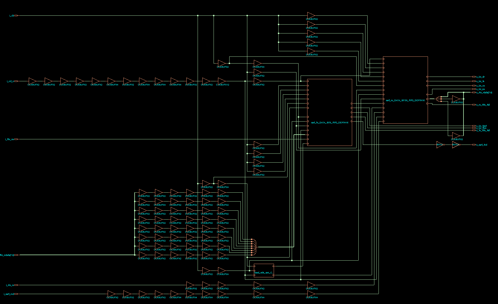

#### (1) 수정 전 (Removal `5 (5%)` Violated)

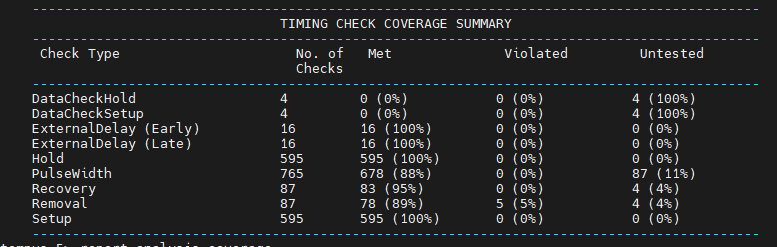

#### (2) 수정 후 (`holdTargetSlack 0.02` 반영: 전 항목 `0 (0%)` Violated)

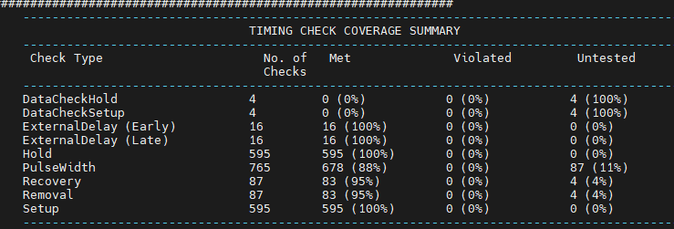

---

## 실행 방법

```bash
cd SoC_make_G45/TOP/PNR
innovus
# uart_pad 단독 칩:
innovus> source uart_pad/uart_pad_0_InitDesign.tcl
# uart_no_pad 코어 블록:
innovus> source uart_no_pad/0_uart_InitDesign.tcl
```
