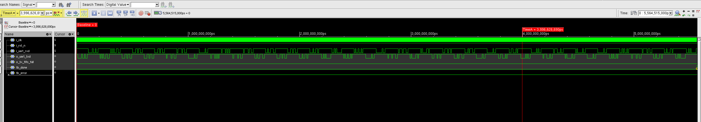
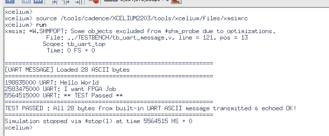
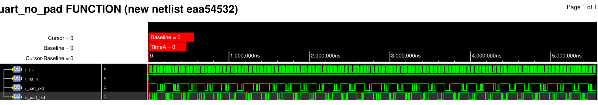
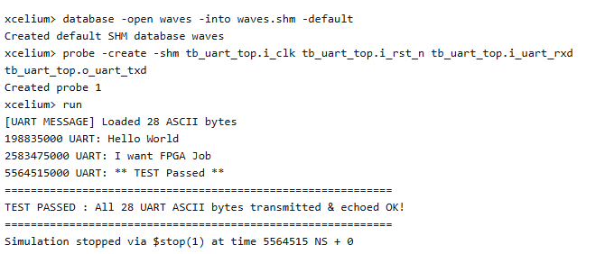

# SIM — UART_GDSII 기능 및 게이트 레벨 시뮬레이션

본 폴더는 Cadence Xcelium(`xrun`)을 사용하여 합성된 **`uart_pad`** 및 **`uart_no_pad`** 게이트 넷리스트의 8E1 직렬 송수신 동작을 검증한 테스트벤치, 실행 스크립트 및 검증 캡처를 정리한다.

---

## 1. 실험 입력 구성

| 대상 | 스크립트 | DUT 넷리스트 | 테스트벤치 | 라이브러리 / 옵션 |
|---|---|---|---|---|
| **`uart_pad` (Zero-delay 기능)** | `FUNCTION/uart_run_function.tcl` | `SYN/uart_mapped/uart_top_syn_final.v` | `TESTBENCH/tb_uart.v` | `pads_FF_s1vg.v` + `fast_vdd1v0_basicCells.v`, `+delay_mode_zero +define+uart_message_sim` |
| **`uart_pad` (Gate+SDF)** | `PRE/uart_run_pre.tcl` | `SYN/uart_mapped/uart_top_syn_final.v` + `uart_top_ss_delays.sdf` | `TESTBENCH/tb_uart.v` | `pads_SS_s1vg.v` + `slow_vdd1v0_basicCells.v`, `+define+sdf_gate` |
| **`uart_no_pad` (Zero-delay 기능)** | `FUNCTION/uart_no_pad_run_function.tcl` | `SYN/uart_block_mapped/uart_top_syn_final.v` | `TESTBENCH/tb_uart.v` | `pads_FF_s1vg.v` + `fast_vdd1v0_basicCells.v`, `+delay_mode_zero +define+uart_message_sim` |

---

## 2. 실행 순서 및 검증 시나리오

1. `SIM/FUNCTION/`에서 `./uart_run_function.tcl` (`uart_pad`) 또는 `./uart_no_pad_run_function.tcl` (`uart_no_pad`) 실행.
2. `tb_uart.v`가 내장 ASCII 메시지 `28 bytes` (`Hello World`, `I want FPGA Job`, `** TEST Passed **`)를 THR로 순차 입력.
3. `o_uart_txd` → `i_uart_rxd` 직렬 루프백 경로를 통해 8E1 프레임 송수신 및 RHR 복호 일치 여부를 전 바이트 자동 검사.
4. `5,564,515 ns` 시점에 `TEST PASSED : All 28 UART ASCII bytes transmitted & echoed OK!` 출력 및 `$stop` 정상 종료 확인.

---

## 3. 검증 결과 및 캡처

### 3-1. `uart_pad` (단독 칩 넷리스트) 시뮬레이션 PASS

### 3-2. `uart_no_pad` (코어 블록 넷리스트) 시뮬레이션 PASS

